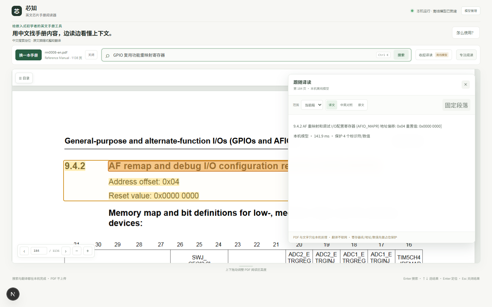

# 芯知 · 英文芯片手册阅读器

给不懂英文的嵌入式初学者用的**本地 PDF 阅读器**：用中文搜手册、跳到原文高亮，读到哪一段就翻哪一段；寄存器位域表和引脚表按结构还原成中文表格。

不是聊天机器人，不把 PDF 发到云端问答。



## 能做什么

| 功能 | 说明 |
| --- | --- |
| **中文搜索定位** | 输入“GPIO 复用功能重映射寄存器”，直接跳到 RM0008 第 184 页 `AFIO_MAPR` 定义并高亮 |
| **跟随译读** | 悬停或 Tab 聚焦英文段落，右侧面板出整段中文；可切原文/译文/中英对照、可固定、可选当前段/前后文/当前页 |
| **选中即译** | 在 PDF 里选中任意单词、表格单元格、半句话，左下角面板直接翻译 |
| **位域表** | 解析 `Bits 26:24 SWJ_CFG[2:0]:` 这类行，输出「位段 / 名称 / 属性 / 说明」表格，说明列可一键翻译 |
| **表格** | 按文字层坐标还原引脚定义表、电气参数表，可切换表格、翻译说明列 |
| **三种翻译引擎** | 本机离线（Argos + CTranslate2）/ 智谱 GLM / DeepL，随时切换 |

## 三种翻译引擎

| | 本机离线 | 智谱 GLM | DeepL |
| --- | --- | --- | --- |
| 费用 | 免费 | 免费额度（有限流） | 50 万字符/月免费 |
| 速度 | 60–150 ms/段 | 批量 3 段约 5 s | 批量 4 段约 1.7 s |
| 中文质量 | 一般（需术语校正） | 较好 | **最好** |
| 需要联网 | ❌ | ✅ | ✅ |
| 需要 key | ❌ | ✅ | ✅ |

在译读面板的「引擎」下拉里切换；走在线时面板顶部会常驻提示“当前段落会发送到 xxx”。

## 快速开始

需要 Node.js 22+（`node --version` 检查）。

```powershell
git clone https://github.com/<你的用户名>/<仓库名>.git
cd <仓库名>

npm install

# 准备翻译运行时（CTranslate2 + SentencePiece，解包到 .runtime/，不改全局 Python）
powershell -ExecutionPolicy Bypass -File tools\setup-runtime.ps1

# 启动（不要用 npm run dev，会 fork 子进程报 spawn EPERM）
node node_modules\next\dist\bin\next dev --hostname 127.0.0.1 --port 3010
```

打开 http://127.0.0.1:3010 。

### Vercel 预览

将 GitHub 仓库导入 Vercel 时选择 **Next.js**，构建命令使用 `npm run build`。连接 GitHub 后，Pull Request 会自动生成独立的 Vercel 预览链接，适合验收界面和本地检索流程。

预览环境可配置以下 Vercel 环境变量来启用在线引擎：`ZHIPU_API_KEY`、`DEEPL_API_KEY`。不要把 key 写入代码或提交到仓库。预览版没有 Windows 本机 Python/CTranslate2 运行时，也不会安装离线模型；因此预览版只验界面、PDF 上传、搜索和在线翻译，离线翻译仍在本地验收。

### 安装离线模型（约 70 MB）

1. 下载 `translate-en_zh-1_9.argosmodel`：
   `https://data.argosopentech.com/argospm/v1/translate-en_zh-1_9.argosmodel`
2. 应用右上角「安装模型」→ 选这个文件。装完断网可用。

### 可选：配置在线引擎

```powershell
# 智谱（https://bigmodel.cn，手机号注册，免费模型 glm-5.3-flashx）
Set-Content -Path .zhipu-key -Value "你的key" -NoNewline

# DeepL（https://www.deepl.com/pro-api，Free 计划 key 以 :fx 结尾）
Set-Content -Path .deepl-key -Value "你的key:fx" -NoNewline
```

两个 key 都已被 `.gitignore` 排除，不会进仓库；界面不会显示 key。

## 验收与测试

```powershell
npx tsc --noEmit --incremental false
npx eslint .
node tools\e2e-api.mjs        # 接口端到端（需要 3010 在跑）
node tools\test-tables.mjs     # 表格解析
node tools\test-bitfields.mjs  # 位域解析
node tools\ui-check.mjs        # 浏览器验收 + 截图（Playwright + 本机 Edge）
```

## 项目结构

```
src/app/page.tsx              首页：搜索、译读面板、模型面板、位域表、选中翻译
src/app/PdfReader.tsx         PDF.js 渲染、文字层、段落/表格坐标、悬停与选中
src/app/TablePanel.tsx        表格面板
src/app/api/translate/        翻译编排（清洗 → 占位 → 引擎 → 还原 → 质检）
src/app/api/model/            模型安装/状态/移除
src/lib/translation/          引擎（本机/智谱/DeepL）、占位保护、清洗、质检、模型管理
src/lib/datasheet/            位域解析、表格解析、通用术语表
src/lib/retrieval.ts          中文搜索排序
runtime/translate_server.py   本机 CTranslate2 推理服务（只监听 127.0.0.1）
tools/                        下载、验收、对照实验等脚本
docs/开发指南.md               改代码前先读这个
outputs/                      各阶段验收记录与截图
```

## 设计取舍

- **翻译不等于词典**：段落译文来自模型，词典只做术语校正和标识符保护；界面始终能区分原文/机器译文/术语辅助。
- **工程标识符先保护再翻译**：寄存器名、位名、`0x` 地址、数值+单位在送翻前替换成 `[[Zn]]`，译后还原；保护密度过高会放弃保护，避免整段变成占位符。
- **垃圾输入先挡**：目录/索引/页码页送进模型会幻觉（实测出现“诸法性相”），`sanitize.ts` 会跳过。
- **退化输出不展示**：模型卡循环输出“包信息 包信息…”时，`quality.ts` 拦截并提示切引擎。
- **表格结构不依赖模型**：位段/列/行由 PDF 文字坐标确定性还原，模型只翻说明文字。

## 已知限制

- **没有 EXE**：目前是本地网页形态，双击即用还没做。
- **表格单元格切分不完美**：跨行说明会串到上一行，合并单元格会错列；矢量线方案试过并回退（见 `outputs/表格解析-记录.md`）。
- **位段选中翻译**会把 `Bits 26:24` 误读成“第 26 章第 24 节”。
- **离线模型质量一般**：会出现“登记器/标针/坦佩尔”这类错译，靠术语校正表兜一部分。
- 扫描件 OCR、跨手册泛化、整册翻译都未实现。

## 文档

- [开发与修改指南](docs/开发指南.md)
- [计划分析与修订建议](outputs/计划分析与修订建议.md)
- [M4 离线整段翻译最小验证](outputs/M4-离线整段翻译最小验证.md)
- [20 段翻译对照结论](outputs/翻译对照-结论.md)
- [泛化实测](outputs/泛化实测.md) / [泛化改进记录](outputs/泛化改进-记录.md)
- [表格解析记录](outputs/表格解析-记录.md) / [体验修复记录](outputs/体验修复-记录.md)
- [DeepL 接入](outputs/DeepL接入.md) / [项目记忆](outputs/项目记忆.md)

## 隐私

- PDF、搜索词、待译文字默认只在本机处理；
- 只有你主动选择在线引擎时，当前段/选中段文字才会发到对应服务（智谱 / DeepL），PDF 文件、文件名、页码都不上传；
- 模型包由用户自己从官方地址下载，仓库不包含模型权重、不包含任何密钥、不包含手册 PDF。

## 许可

代码：待定（默认建议 MIT）。
离线模型：Argos `translate-en_zh` 派生自 OPUS-MT，包内声明原始模型为 **CC-BY 4.0**，分发前请单独核对训练数据与再分发条款。
